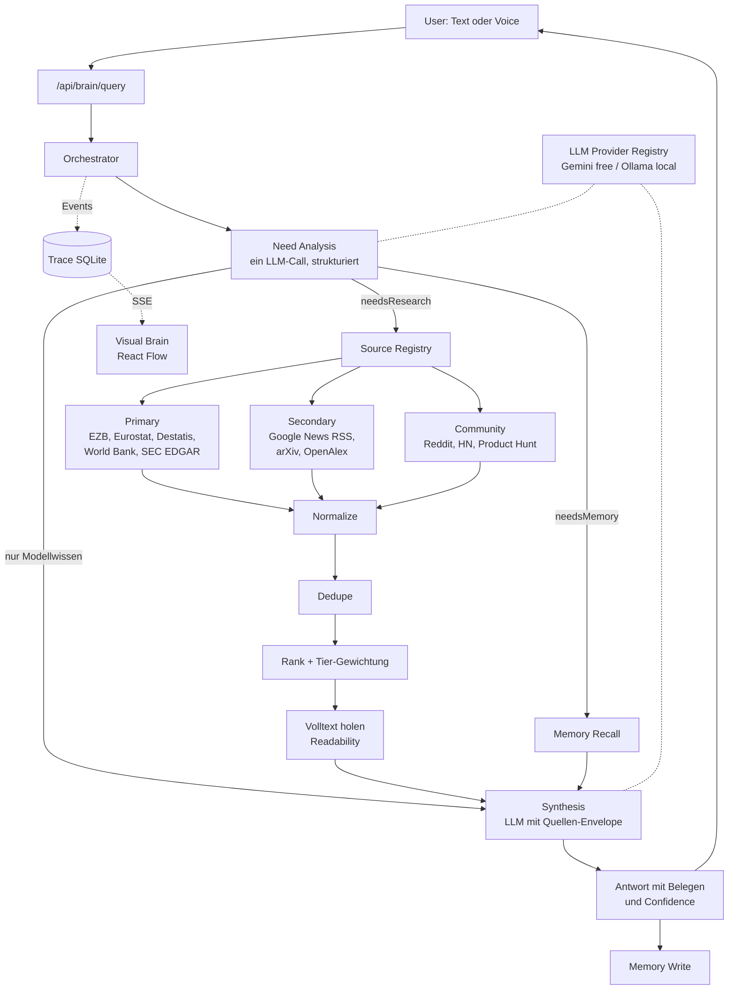

# Universal Brain — V1 Architekturplan

**Stand:** 2026-09-10 · **Status:** freigegeben · **Branch:** `brain-v1`

Dieses Dokument ist der verbindliche Architekturstand für V1.
Spätere Änderungen werden gegen dieses Dokument geprüft. Wenn Code und
Dokument auseinanderlaufen, ist das ein Fehler, der behoben wird.

---

## 1. Leitprinzipien

    FUNCTIONAL FIRST.
    MODULAR SECOND.
    ADVANCED FEATURES LATER.
    COSTS AS LOW AS POSSIBLE.

Vier Regeln, die jede Entscheidung in V1 dominieren:

1. **Kein Feature ohne echte Funktion.** Eine Komponente darf in der UI
   erst als aktiv erscheinen, wenn sie einen echten externen Aufruf macht.
   Status-Werte: `CONNECTED`, `NOT_CONFIGURED`, `DISCONNECTED`, `ERROR`,
   `SIMULATION`, `NOT_IMPLEMENTED`. Einzige Quelle: `/api/health`.
2. **Running Cost bleibt bei rund 0 Euro.** Kostenpflichtige Dienste werden
   erst nach dem Engpass-Verfahren (Abschnitt 8) beschafft.
3. **Kein Agent-Schwarm.** Ein Orchestrator-Loop. Spezialagenten entstehen
   erst bei nachgewiesenem Bedarf.
4. **Internet ist Daten, nicht Anweisung.** Alles Abgerufene geht im
   Envelope in den Prompt und kann das Systemverhalten nicht ändern.

---

## 2. Zielarchitektur V1

    USER → CENTRAL BRAIN → LLM + INTERNET + MEMORY → ANALYSE → ANSWER



### Drei tragende Entwurfsentscheidungen

**Source Registry statt Suchmaschine.** Eine verlässliche kostenlose
generische Websuche existiert nicht. Für Wirtschaft, Politik und Unternehmen
sind typisierte Primärquellen ohnehin besser: die EZB liefert den Leitzins
direkt, statt dass ein Modell ihn aus einem Blogartikel schätzt. Generische
Suche wird später ein weiterer Adapter im Registry, kein Umbau.

**Der Quellen-Envelope ist eine Sicherheitsgrenze.** Da V1 keine
schreibenden Tools besitzt, ist der Schaden eines erfolgreichen
Injection-Versuchs auf eine falsche Antwort begrenzt.

**Der Trace ist die einzige Quelle der Visualisierung.** Kein Trace-Event,
kein aktiver Knoten. Damit ist die Anti-Fake-Regel strukturell erzwungen
statt nur vereinbart.

---

## 3. Provider-Struktur

Der Orchestrator kennt **nur** das Interface, niemals einen konkreten Anbieter.

    LLMProvider (Interface)
    ├── GeminiProvider     Free Tier, primär in V1
    ├── OllamaProvider     lokal, vorbereitet, blockiert V1 nicht
    └── weitere            später

```
src/brain/providers/
  types.ts       interface LLMProvider { id, complete(), completeStructured(), health() }
  gemini.ts
  ollama.ts
  registry.ts    Auswahl, Health-Check, Fallback
```

### Regeln

- Kein `import` eines konkreten Providers ausserhalb von `providers/`.
  Der Orchestrator holt sich Provider ausschliesslich über `registry.ts`.
- Provider-Wechsel erfolgt per Umgebungsvariable, ohne Codeänderung.
- Fällt der primäre Provider aus, greift der Fallback. Ist keiner
  verfügbar, meldet `/api/health` `DISCONNECTED` statt einer stillen Notlüge.
- Kein Multi-Model-Consensus in V1. Die Schicht muss ihn später erlauben,
  ohne dass die Brain-Logik angefasst wird.

### Vertraulichkeits-Routing (vorbereitet, aktiv ab späterem Schritt)

Free Tiers dürfen Eingaben zur Produktverbesserung verwenden. Das Brain
speichert Projekte, Ziele und Entscheidungen. Deshalb erhält jede Anfrage
eine Sensitivitäts-Markierung, und das Routing respektiert sie:

| Sensitivität | Routing |
|---|---|
| `PUBLIC` | Cloud-Provider erlaubt |
| `INTERNAL` | Cloud erlaubt, aber ohne Memory-Kontext im Prompt |
| `CONFIDENTIAL` | ausschliesslich lokaler Provider; ist keiner da, wird abgelehnt statt gesendet |

In V1 wird das Feld gesetzt und durchgereicht. Die Durchsetzung wird
aktiviert, sobald `OllamaProvider` einsatzbereit ist. Bis dahin gilt: keine
vertraulichen Inhalte ins Brain geben.

---

## 4. Freshness-Logik

**Ersetzt die verworfene pauschale Sechs-Stunden-Regel.**
Aktualität hängt vom Informationstyp ab, nicht von einer globalen Zahl.

| Klasse | Beispiel | Memory-Lebensdauer |
|---|---|---|
| `EVERGREEN` | Definitionen, Geschichte, Grundlagenwissen | 90 Tage |
| `SLOW_CHANGING` | Unternehmensstruktur, allgemeine Marktinformation | 14 Tage |
| `CURRENT` | Nachrichten, Wirtschaftsentwicklung, Politik | 6 Stunden |
| `REALTIME_SENSITIVE` | Breaking News, Kurse, heutige Bekanntmachungen | 0, immer neu abrufen |

### Ablauf

1. Der Planner klassifiziert die Anfrage und liefert die Klasse im Plan-Objekt.
2. Ein deterministischer Recency-Filter prüft die Formulierung auf:
   `aktuell`, `heute`, `gerade`, `jetzt`, `neueste`, `latest`, `momentan`,
   `diese Woche`, `breaking`, `kurs`, `preis`.
3. Der Filter darf die Klasse **nur verschärfen**, niemals abschwächen.
   Das ist bewusst asymmetrisch: eine Regel kann Frische erzwingen, aber das
   Modell kann das System nicht dazu überreden, veraltete Daten zu verwenden.
4. Ein Memory-Treffer wird nur dann statt einer Recherche verwendet, wenn
   sein Alter unter der Lebensdauer seiner Klasse liegt.
5. **Memory wird in jedem Fall als zusätzlicher Kontext mitgegeben**, auch
   wenn neu recherchiert wird. Frische ersetzt Kontext nicht.
6. Jeder Memory-Eintrag speichert Klasse, Veröffentlichungsdatum und
   Abrufdatum. Ohne Abrufdatum gilt ein Eintrag als abgelaufen.

---

## 5. Free-First Technology Stack

| Komponente | Free Option | Limitation | Paid Upgrade später |
|---|---|---|---|
| LLM primär | Google AI Studio, Gemini | Rate-Limit pro Minute und Tag. Eingaben können zur Produktverbesserung genutzt werden. | Gemini Paid, Claude, GPT |
| LLM sekundär | Ollama lokal (M5, 16 GB) | Installation nötig, rund 5 GB pro Modell, 7-8B-Modelle laufen gut, schwächer im Reasoning | Mehr RAM, grössere Modelle |
| LLM Alternative | Groq Free Tier | Rate-Limit, offene Modelle | Groq Paid |
| Suche allgemein | keine verlässliche kostenlose Option | echte Lücke, siehe Abschnitt 8 | Brave Search API, Tavily |
| Nachrichten | Google News RSS, GDELT | nur Überschrift und Link, Volltext separat | Nachrichten-API |
| Wirtschaftsdaten | EZB Data Portal, Eurostat, World Bank (ohne Key); Destatis, FRED (kostenloser Key) | verzögert, teils quartalsweise | Wirtschaftsdatenbank |
| Unternehmensdaten | SEC EDGAR (ohne Key) | nur US-Unternehmen | Unternehmensdatenbank |
| Börsendaten | Stooq CSV, Alpha Vantage Free | verzögert, harte Tageslimits | Echtzeit-Feed |
| Wissenschaft | arXiv, OpenAlex, Crossref, PubMed | kein Volltext bei Paywall | Verlagszugang |
| Community | Reddit JSON, HN Algolia, Product Hunt RSS | Reddit drosselt unauthentifiziert | Reddit API Key |
| Seiten-Volltext | `@mozilla/readability` + `linkedom`, lokal | Paywalls und Bot-Schutz bleiben zu | Scraping-Dienst |
| Datenbank | SQLite via `better-sqlite3` | ein Prozess, kein Netzwerkzugriff | Postgres |
| Memory-Suche | SQLite FTS5 | keine semantische Ähnlichkeit | Embeddings |
| Vektorsuche | Ollama `nomic-embed-text` + Kosinus im Speicher | bis einige tausend Einträge | pgvector |
| Voice STT | Web Speech API im Browser | Chrome und Safari, Audio geht bei Chrome an Google | Deepgram, Whisper API |
| Voice TTS | `speechSynthesis` im Browser | Systemstimme | ElevenLabs |
| Hosting | lokal, `npm run dev` | nur auf diesem Rechner | Railway, Fly |
| Monitoring | eigene Trace-Tabelle plus `/trace` | kein Alerting | Langfuse |

**Docker ist auf diesem Rechner nicht installiert.** Deshalb ist
SearXNG (kostenlose selbstgehostete Meta-Suche) für V1 keine Option und
erst der Zwischenschritt vor einer bezahlten Such-API.

---

## 6. Kosten

**Running Cost V1: rund 0 Euro pro Monat**, solange lokal betrieben.

| Posten | V1 | Wann Kosten entstehen könnten |
|---|---|---|
| LLM | 0 über Free Tier | viele tiefe Recherchen pro Tag, Rate-Limit |
| Suche | 0 über Quellen-Registry | Fragen ausserhalb der abgedeckten Domänen |
| Datenbank | 0, SQLite lokal | erst bei Multi-User |
| Voice | 0, Browser-APIs | nur bei Qualitätsanspruch |
| Hosting | 0, lokal | Zugriff von unterwegs |
| Marktdaten | 0, verzögert | echter Realtime-Bedarf |

**Development Cost:** Zeit, neun Roadmap-Schritte. Der Kern sind die
Schritte 2 bis 4.

---

## 7. Legacy-Regeln

Das Video-System liegt vollständig unter `legacy/video/`. Details in
`legacy/video/README.md`.

1. **Nichts wird unwiederbringlich gelöscht.** Ausnahme: die fünf rein
   simulierten Agents, die per `git rm` entfernt und über die Git-Historie
   wiederherstellbar sind.
2. **`legacy/` ist vom Build und vom Typecheck ausgeschlossen** über
   `tsconfig.json`. Das ist eine erzwungene Grenze, keine Vereinbarung.
3. **Kein Import aus `src/` nach `legacy/` und umgekehrt.** Wird Code aus
   legacy gebraucht, wird er bewusst geerntet und neu geschrieben, nicht
   importiert.
4. **Ernten heisst kopieren und bereinigen**, nicht referenzieren. Aus
   `trend-agent.ts` werden in Schritt 4 genau sechs Funktionen übernommen:
   `parseRSS`, `fetchGoogleNews`, `fetchHackerNews`, `fetchReddit`,
   `fetchProductHunt`, `clusterSources`. Alles Nischen-, Hook-, Prognose-
   und `Math.random`-basierte Verhalten bleibt liegen.
5. **Video kann später als Tool zurückkehren**, über einen Adapter in
   `src/brain/tools/`. Niemals als Kern-Domäne.

---

## 8. Engpass-Verfahren für kostenpflichtige Dienste

Ein bezahlter Dienst wird nie einfach beschafft. Bei einem Engpass wird
folgendes vorgelegt und danach gemeinsam entschieden:

1. aktuelles Problem
2. kostenlose Alternative
3. deren konkrete Grenze
4. kostenpflichtige Alternative
5. konkreter Mehrwert
6. erwartete Kosten

Die Datengrundlage dafür liefert der Trace: er zählt ab Schritt 3, wie oft
ein Rate-Limit greift und wie oft eine Quelle nichts Brauchbares liefert.

---

## 9. Modulstruktur

```
src/
  brain/
    orchestrator.ts        Der Loop
    plan.ts                Need-Analysis, strukturierter LLM-Call, Freshness-Klasse
    synthesis.ts           Antwort mit Belegen und Confidence
    trace.ts               Run- und Step-Logging, Muster aus job-store.ts
    capabilities.ts        Echter Status je Integration
    types.ts
    providers/             types, gemini, ollama, registry
    research/
      registry.ts          Quellen mit Tier, Kosten, Domäne, Adapter
      sources/             google-news, hackernews, reddit, producthunt,
                           wikipedia, ecb, eurostat, worldbank, sec-edgar, arxiv
      rss.ts               geerntet
      normalize.ts
      dedupe.ts            geerntet
      rank.ts
      extract.ts           Readability-Volltext
      envelope.ts          Injection-Grenze
    memory/
      db.ts                better-sqlite3, Schema, Migrationen
      store.ts             user, project, decision, knowledge, conversation
      recall.ts            FTS5 plus Freshness-Prüfung
    tools/
      types.ts             BaseTool, aus base.ts ohne simulate()
      index.ts             In V1 nur research und memory
  app/
    page.tsx               System Status
    brain/page.tsx         Chat plus Flow-Ansicht
    trace/page.tsx         Runs, Quellen, Dauern, Fehler
    api/health/route.ts    Capability Report
    api/brain/query/route.ts   SSE-Stream
  components/
    brain/                 BrainFlow, SourceList
    ui/                    Card, Badge
  lib/utils.ts
legacy/video/              archiviert, vom Build ausgeschlossen
docs/BRAIN-V1-PLAN.md      dieses Dokument
```

### Memory (Schritt 6)

Fünf Arten in derselben SQLite-Datei: `user`, `project`, `decision`,
`knowledge`, `conversation`.

**Schreibstrategie.** Es wird nicht alles gespeichert. `user`, `project` und
`decision` entstehen ausschliesslich aus dem, was der Nutzer selbst
geschrieben hat, vorgeschlagen vom Planner im selben Modellaufruf, der ohnehin
stattfindet. Kein zusätzlicher Aufruf, keine zusätzlichen Kosten. Inhalte aus
dem Internet kommen niemals ins Langzeitgedächtnis: sie sind untrusted input
und hätten sonst einen dauerhaften Weg in spätere Antworten. `knowledge` wird
nur bei Beleglage `HIGH` oder `MEDIUM` geschrieben, damit sich schlecht
Belegtes nicht festsetzt.

**Abrufstrategie, bewusst zweigeteilt.** `user`, `project` und `decision`
werden immer mitgeliefert, neueste zuerst. `knowledge` und `conversation`
kommen über die Volltextsuche.

Der Grund ist gemessen: reine Stichwortsuche scheitert im Deutschen an
Komposita und Beugung. Die Frage "Welche rechtlichen Punkte muss ich bei
meinem geplanten Unternehmen beachten?" fand den Eintrag "SaaS-Gründung
Buchhaltungssoftware für deutsche Kleinunternehmen" NICHT, weil FTS5
"Unternehmen" und "Kleinunternehmen" als verschiedene Wörter behandelt.
Semantische Suche löst das, braucht aber Embeddings und ist erst V3.

**Frische.** Dieselbe Regel wie beim Research-Cache, zum zweiten Mal
angewandt: ein Treffer gilt nur als Fakt, wenn sein Alter unter der
Lebensdauer seiner Klasse liegt. `REALTIME_SENSITIVE` ist sofort veraltet,
gespeichertes Wissen kann eine Echtzeitfrage also grundsätzlich nicht
beantworten. Veraltete Treffer werden nicht verschwiegen, sondern im Prompt
als VERALTET markiert und bleiben Kontext.

**Kontrolle.** `/memory` zeigt alles Gespeicherte und erlaubt, jeden Eintrag
zu löschen.

### Belegstärke (Schritt 5)

`src/brain/research/confidence.ts` rechnet aus der tatsächlichen Quellenlage
eine Einstufung: `HIGH`, `MEDIUM`, `LOW` oder `NONE`.

Bewusst deterministisch und ohne LLM. Eine Confidence, die das Modell selbst
vergibt, ist eine Selbsteinschätzung und damit genau die Art Aussage, der man
nicht trauen kann. Gerechnet wird nur Nachprüfbares: Anzahl je Vertrauensstufe,
Alter der jüngsten Quelle gegen die Anforderung der Frische-Klasse, Quellen ohne
Datum, Anzahl unabhängiger Quellen.

`HIGH` verlangt alle drei Bedingungen zugleich: mindestens eine Primärquelle,
ausreichende Aktualität für die geforderte Klasse, mindestens zwei unabhängige
Quellen. Fällt eine weg, ist es höchstens `MEDIUM`.

Das Modell darf die Einstufung begründen, aber nicht neu vergeben. Es bekommt
die gerechneten Beobachtungen in der Systemanweisung und soll sich darauf
stützen.

**Benennung:** die Zahl beschreibt die BELEGLAGE, nicht die Wahrheit. Eine gut
belegte Aussage kann falsch sein, eine schlecht belegte richtig. Oberfläche und
Prompt sagen deshalb "Belegstärke", nicht "Sicherheit".

### Quellen-Tiers

| Tier | Beispiele | Verwendung |
|---|---|---|
| `PRIMARY` | Behörden, Zentralbanken, Statistikämter, Geschäftsberichte, Originalarbeiten | harte Fakten |
| `SECONDARY` | seriöse Medien, Research Reports, Analysen | Einordnung |
| `COMMUNITY` | Reddit, Foren, Social Media | Trends, Meinungen, Stimmung, Nutzerprobleme |

Community-Quellen werden **nie** als Faktenbeleg ausgegeben.

---

## 10. Roadmap

| Schritt | Ziel | Was gebaut wird | Erfolgskriterium |
|---|---|---|---|
| 1 | Repository aufräumen | Video nach `legacy/video`, Prisma raus, fünf simulierte Agents entfernt, `simulate()` gestrichen, tsconfig-Ausschluss | `npx tsc --noEmit` und `npm run build` grün; `src` enthält keine Video-Domäne |
| 2 | Echtes LLM | Provider-Interface, Gemini, Ollama, Registry mit Health-Check und Fallback | Dieselbe Frage über beide Provider beantwortbar; Wechsel per Env ohne Codeänderung; fehlender Key meldet `NOT_CONFIGURED` statt Absturz |
| 3 | Central Brain | Orchestrator, Planner, Synthesis, Trace, `/api/brain/query` als Stream | Wissensfrage ohne Recherche, Aktualitätsfrage mit Recherche, Trace zeigt beide Wege unterschiedlich |
| 4 | Research Layer | Registry, vier geerntete Quellen, Normalisierung, Dedupe, Ranking, Readability, Envelope | AI-Business-Frage liefert mindestens fünf echte klickbare Quellen; Ausfall einer Quelle bricht nichts ab |
| ✅ 4b | Einfaches Visual Brain | React Flow mit fünf Knoten, gespeist aus dem echten Trace | INTERNET leuchtet nur bei echter Recherche, MEMORY zeigt Idle wenn kein Treffer; keine simulierten Animationen |
| ✅ 5 | Quellen und Vertrauen | Tier-Klassifikation, EZB, Eurostat, World Bank, SEC EDGAR, Wikipedia, arXiv, Datumsfelder, Confidence | EZB-Leitzins kommt aus der EZB-Quelle mit Veröffentlichungs- und Abrufdatum; Reddit-Meinung nie als Fakt |
| ✅ 6 | Memory | SQLite-Schema, fünf Memory-Arten, FTS5-Recall, Freshness-Klassen, Schreibstrategie | Neue Sitzung kennt das Projekt aus der vorigen; `CURRENT`-Treffer unter 6 h wird wiederverwendet, `REALTIME_SENSITIVE` niemals |
| 7 | Vollständiges Visual Brain | Ausgebaute Flow-Ansicht, `/trace`, Quellenanzeige | Jeder Run vollständig nachvollziehbar; kein Zustand hartkodiert |
| 8 | Voice | Web Speech API als austauschbare Ein- und Ausgabeschicht | Gesprochene Frage, gesprochene Antwort; ohne Voice funktioniert Text unverändert |
| 9 | Tests und Härtung | Sieben Testfälle als Skript, Timeouts, Retries, Rate-Limit-Behandlung, Injection-Test | Alle sieben laufen durch; eine Testseite mit eingebetteten Anweisungen ändert das Verhalten nicht |

### Arbeitsweise pro Schritt

1. implementieren
2. Build, TypeScript und Tests prüfen
3. dokumentieren, was tatsächlich geändert wurde
4. aufgetretene Probleme nennen
5. erst dann weiter

Nicht mehrere Schritte gleichzeitig.

---

## 11. Sicherheit in V1

Angemessen für einen Nutzer, lokal, ohne Overengineering:

- Keine Keys im Quellcode, ausschliesslich Umgebungsvariablen
- Internetinhalte gehen im Envelope in den Prompt und gelten als Daten
- Keine schreibenden externen Aktionen. Kein Versand, kein Kauf, keine
  Veröffentlichung, keine Kontoänderung, keine Dateilöschung ausserhalb
  definierter Bereiche
- Timeouts und einzeln gekapselte Fehler pro Quelle
- Kein Auth-System, kein Rollenmodell, kein Multi-Tenant in V1

---

## 12. Was V1 ausdrücklich nicht enthält

Spezialagenten für Business, Finance, Politik oder Wissenschaft ·
Multi-Model-Consensus · Realtime-Marktdaten · SaaS · Multi-User ·
Enterprise-Auth · autonome externe Aktionen · Video ·
kostenpflichtige Premium-APIs · komplexe Vektor-Infrastruktur

---

## 13. Wiederherstellung am 2026-10-25

Das Projekt lag unter `~/Desktop/ai-content-os` und ist verschwunden, vermutlich
im Zuge der Google-Drive-Synchronisierung des Desktops. Der Branch `brain-v1`
mit sechs Commits war nie auf GitHub gepusht, dort stand nur der alte
Video-Stand vom 30. Juni.

Wiederhergestellt wurde aus dem Claude-Code-Sitzungsprotokoll, das jede
geschriebene Datei im Volltext enthält. 48 Dateien kamen zurück. Die
Nachbesserungen, die nach dem letzten vollständigen Schreiben einer Datei
erfolgt waren, mussten erneut angewandt werden; die Testsuite hat das bestätigt.

Zwei Konsequenzen für die weitere Arbeit:

1. **Das Projekt liegt jetzt unter `~/Projekte/universal-brain`**, bewusst
   nicht auf dem Desktop und nicht in einem synchronisierten Ordner.
2. **Nach jedem Roadmap-Schritt wird gepusht**, nicht nur committet.
